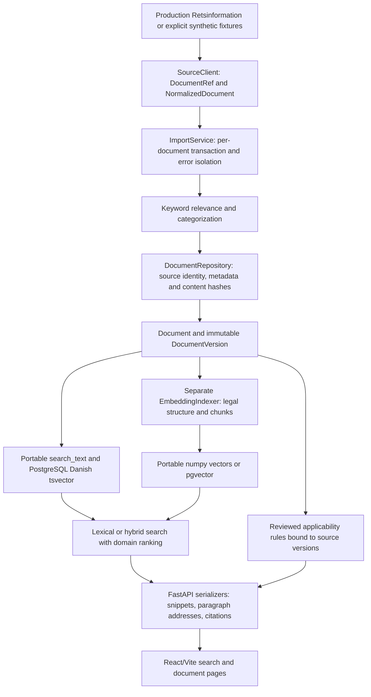

# Architecture audit — 2026-10-22

Inspected checkout: `Jtryk26/Maritime-law-API`, baseline
`b02f9fd97b68f92f6ee34a1e48c9e9d6842285a4`. This is an audit of local source
and isolated development checks, not of the deployed service or legal coverage.

## Baseline and safety

The initial checkout was clean on branch `work`. Development now uses branch
`codex/international-catalogue-20261022` in the existing isolated checkout.
No worktree, reset, merge, push, production migration, or deployment was used.
Session plans and milestone status live outside the checkout. No AGENTS.md was
added or modified. The attached roadmap is a specification, not evidence that
its described capabilities already exist.

Runtime: Python 3.12.14, Node 24.19.0, npm 11.9.0. Backend requirements pin direct
dependencies; transitive Python packages are not locked. Frontend installs use
the existing package-lock.json with `npm ci`. SQLite is explicitly supported
for development; production uses PostgreSQL 16 and optionally pgvector.

## Source-to-search flow



## Existing integration points

| Area | Actual implementation and constraints |
| --- | --- |
| Sources | `services/retsinformation/base.py` supplies DocumentRef, NormalizedDocument and SourceClient. The factory accepts production or fixture explicitly. Production never silently falls back. No international adapter exists. |
| Ingestion | ImportService and DocumentRepository preserve `(source, source_id)`, raw and normalized metadata, retrieval timestamps, hashes and change logs. The maritime score gate is Danish keyword based; international catalogue imports need an explicit reviewed route through these abstractions. |
| Versions | Document points at a current DocumentVersion. Versions carry content, hashes, metadata_json and retrieval time. Content is immutable in ordinary ingestion; metadata-only changes do not create a content version. |
| Search | PostgreSQL FTS and a portable SQLite backend share filters. Vector and hybrid backends add chunk matches, RRF and domain ranking. Paragraph citations come from structural parsing. Existing Danish IDs, ranking and paragraph URLs are compatibility boundaries. |
| Rights | No source-rights registry, evidence model or action-specific rights gate exists. Content, raw metadata, search_text, vectors and API serializers currently assume ingested text may be used. Source accessibility is not a licence. New sources must remain closed until rights controls exist. |
| Applicability | Both original applicability tables and the newer vessel rule/event tables exist. Vessel rules bind to DocumentVersion, verify quoted source text and hashes, and require human review/separation of duties. Reuse these; do not infer rules from semantic similarity or add a replacement engine. |
| Frontend | React 18 and Vite 5; hash routes for search, document and ship assessment. Source code has no public admin/login page despite stale README/router comments. Vite proxies `/api` and `/health`; VITE_API_TARGET is configurable. |
| Operations | CLI owns import, migration, seed, backfill/discovery, embedding, ranking and rule review. Docker defines database, backend, frontend and an opt-in maintenance profile. Source and model downloads are separate concerns. |

## API inventory

Public reads: `/api/search`, `/api/documents`, document detail/version/structure/
similar routes, `/api/categories`, `/api/facets`, `/api/core-laws`, and
`/api/search/related`. `/health` checks the actual database connection.

Public rule evaluation: `/api/applicability/fields`, POST
`/api/applicability/evaluate`, `/api/applicability/rules/{rule_id}`, POST
`/api/v1/applicability/evaluate`, and `/api/v1/applicability/rules/approved`.
These evaluation POSTs do not approve or mutate rules.

Administrative router: `/api/admin/session`, `/api/import/run`, import run
history/detail, `/api/stats`, `/api/embeddings/status`, `/api/embeddings/run`,
and `/api/search/queries`. Authentication is applied to the entire router.
ENABLE_ADMIN_API=false omits it. Missing admin credentials fail closed; CLI
maintenance can run without an HTTP credential. Production invariants reject
unsafe admin/docs/migration settings. Preserve these boundaries for new routes.

## Schema and migration baseline

Alembic has one head: `0009_vessel_rules_source_document`. The isolated
development database reports that same revision. There are 21 ORM tables:

- documents, document_versions, categories, document_categories, import_runs,
  change_log, backfill_manifest_items;
- curated_relevance_overrides, curated_relevance_override_events,
  document_chunks, search_queries;
- applicability_rules, applicability_citations, applicability_conditions,
  applicability_exclusions, applicability_discretion, applicability_coverage_gaps,
  applicability_draft_runs, applicability_review_events;
- vessel_applicability_rules, vessel_applicability_rule_events.

The ORM deliberately omits dialect-specific tsvector/pgvector columns managed
by migrations. Preserve PostgreSQL's 63-character identifier limit and the
widened Alembic version column. Existing offline migration tests compile later
migrations as PostgreSQL SQL; they do not exercise a live PostgreSQL server.

## Validation evidence

Run from backend with the repository virtual environment:

```
../.venv/bin/python -m pytest --junitxml=/tmp/maritime-backend-tests.xml
../.venv/bin/python -m alembic heads
DATABASE_URL=sqlite:////workspace/.maritime-dev/development.db ../.venv/bin/python -m alembic current
```

Baseline outcome: **883 passed, 2 expected failures**, 113.67 seconds. The two
xfails concern two deliberately unresolved mixed maritime/aviation relevance
titles, not passes or newly skipped tests.
The suite uses fresh migrated SQLite databases and hashing embeddings; it does
not download a language model. Do not set EMBEDDINGS_ENABLED=false globally
when running this suite.

Frontend, from frontend: `NPM_CONFIG_CACHE=/workspace/.cache/npm npm ci
--include=dev --no-audit --no-fund`, then `npm run build`: passed, 45 modules.

The existing `scripts/verify_api.py` passed against a fresh isolated SQLite API
on port 8001, including import idempotence, versioning, search/ranking, document
structure, hash-vector pipeline and auth. Its burst exceeds the default search
quota; only that test server used 600 general/300 search requests per minute.
No assertions were bypassed. Hash vectors do not validate semantic quality.

The development API and Vite ran with the default rate limits. Local requests
verified health, nonempty lexical search, synthetic document body/provenance,
the Vite page/module, and identical results through Vite's API proxy. The
installation script ran twice and preserved the populated development DB.

Not validated: live production harvest, real embedding model inference, live
PostgreSQL/pgvector, international provider access/rights, deployment, or
restoration in a new cloud task. These are not implied by the checks above.
